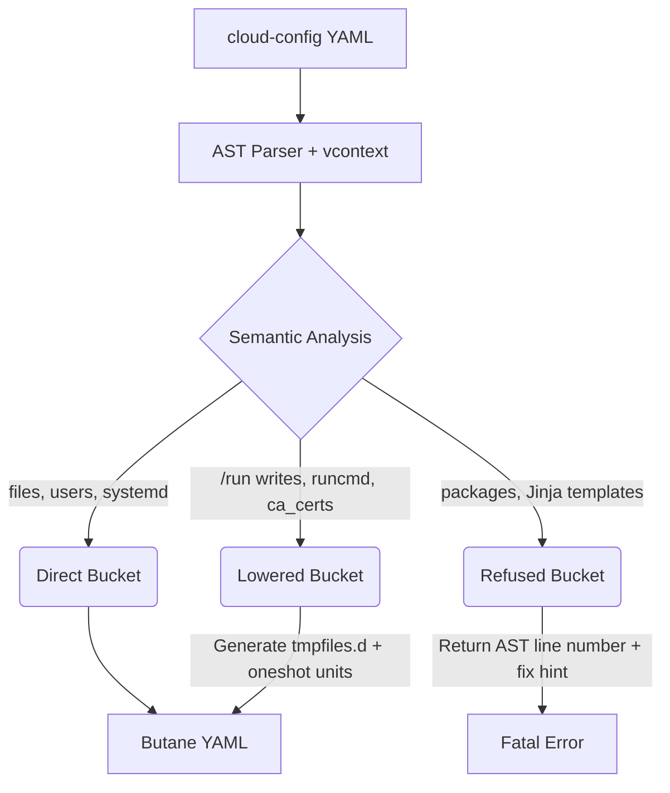

# cloud-init-to-butane

[](https://github.com/Aryanbhargava18/cloud-init-to-butane/actions/workflows/ci.yml)

A Go transpiler converting standard `cloud-config` into [Butane](https://coreos.github.io/butane/) YAML (Ignition spec v3) for Flatcar Container Linux — scoped specifically to [ClusterAPI](https://cluster-api.sigs.k8s.io/) worker node provisioning.

## The Problem

Flatcar Container Linux boots from an immutable filesystem using [Ignition](https://coreos.github.io/ignition/), which runs *once* in the `initramfs` before the real root is mounted.

Tools like Cluster API (CAPI) generate `cloud-config` files via `bootstrap/kubeadm`. Converting `cloud-config` to Butane is **not** a simple field-by-field YAML mapping. A naive mapping produces a config that validates perfectly but fails silently at runtime.

The two critical failure modes for CAPI worker provisioning:

1. **`/run` is not mounted at Ignition time.** CAPI's worker template writes `kubeadm-join-config.yaml` to `/run/kubeadm/`. Ignition's own docs state that `/run` and `/tmp` are expected to be mount points and that writing to them during provisioning will not have the intended effect.

2. **`runcmd` has no declarative Ignition equivalent.** The kubeadm join command must run *after* tmpfs mounts are available — otherwise the config it reads from `/run/` doesn't exist yet.

This transpiler implements an AST-aware parser and an OS-level translation layer that understands the semantics of Flatcar boot operations.

## Architecture

The transpilation pipeline divides all input directives into three semantic buckets:



## Supported Fields

| cloud-config field | Bucket | Butane output |
|---|---|---|
| `write_files` (regular paths) | Direct | `storage.files[]` |
| `write_files` encoding: `base64`, `gz`, `gz+base64` | Direct | Decoded inline in `storage.files[]` |
| `write_files` paths under `/run/` or `/tmp/` | **Lowered** | Staged to `/var/tmp/cloud-init-staged/…` + `tmpfiles.d` copy rule |
| `write_files` `.network` / `.netdev` / `.link` | Direct | `storage.files[]` under `/etc/systemd/network/` |
| `users[].name`, `ssh_authorized_keys`, `groups` | Direct | `passwd.users[]` |
| `users[].sudo` | Lowered | `/etc/sudoers.d/<name>` file at mode 0440 |
| `coreos.units[].name`, `.content`, `.dropins` | Direct | `systemd.units[]` |
| `ca_certs.trusted[]` | Lowered | `/etc/ssl/certs/cloud-init-N.pem` + `update-ca-certificates.service` |
| `runcmd` / `preKubeadmCommands` | Lowered | `/opt/cloud-init/runcmd.sh` + `cloud-init-runcmd.service` (oneshot, `After=systemd-tmpfiles-setup.service`) |
| `hostname` | Lowered | `/etc/hostname` |

## Explicit Non-Goals

These will not be implemented. The scope is CAPI worker provisioning only.

| cloud-config field | Reason |
|---|---|
| `packages` / `apt` / `yum_repos` | Flatcar is immutable. Use `systemd-sysext` for layered extensions. |
| `## template: jinja` | Jinja templating is runtime-resolved by `cloud-init`. Use `coreos-metadata.service` + `EnvironmentFile=` instead. |
| `coreos.units[].command` | Imperative unit commands (start/stop/reload) have no declarative Ignition equivalent. |
| `coreos.units[].runtime` | Runtime-only unit modifications cannot be expressed in a provisioning config. |
| `coreos_ssh_import_github` / `etcd2` / `fleet` | Deprecated in Ignition v3. |

## The Lowering Bucket Explained

### 1. The `/run` and `/tmp` lifecycle problem

CAPI's worker template (`bootstrap/kubeadm/pkg/cloudinit/node.go`) writes:
- `/run/kubeadm/kubeadm-join-config.yaml` at mode `0640`
- `/run/cluster-api/placeholder`

Then immediately runs `kubeadm join --config /run/kubeadm/kubeadm-join-config.yaml`.

Ignition runs in the `initramfs` before `/run` (tmpfs) is mounted. Writing to `/run` during provisioning is silently discarded at boot. CAPI's own CLC implementation documents this: it relocates the config to `/etc/kubeadm.yml` with a note that placing config in `/tmp` "is not possible with Ignition."

**Our solution** — instead of rewriting the shell command (fragile), we stage `/run` writes to `/var/tmp/cloud-init-staged/run/…` and generate a `tmpfiles.d(5)` copy rule that materializes the file at the exact path expected by the downstream script:

```
# /etc/tmpfiles.d/cloud-init-run-kubeadm-kubeadm-join-config.yaml.conf
C /run/kubeadm/kubeadm-join-config.yaml 0640 root root - /var/tmp/cloud-init-staged/run/kubeadm/kubeadm-join-config.yaml
```

### 2. The `runcmd` sequencing problem

`cloud-init` runs `runcmd` after the system boots and tmpfs mounts are available. Ignition has no declarative equivalent.

**Our solution** — `runcmd` and `preKubeadmCommands` are bundled into `/opt/cloud-init/runcmd.sh` and driven by a `cloud-init-runcmd.service` oneshot unit with:

```ini
After=systemd-tmpfiles-setup.service containerd.service
```

This ensures staged `/run` files exist before `kubeadm join` runs. The unit also sets a sentinel (`/var/lib/cloud-init-runcmd-done`) to prevent re-execution on subsequent boots.

### 3. AST-accurate error reporting

Using `gopkg.in/yaml.v3` and `coreos/vcontext`, source line numbers are preserved. Un-transpileable directives produce actionable errors:

```
$ cloud-init-to-butane --in capi-worker.yaml
Parse error: line 1: Jinja templating is not supported by Ignition. Use coreos-metadata.service and EnvironmentFile= instead.

$ cloud-init-to-butane --in packages.yaml
Transpile error: line 2: packages has no Flatcar equivalent; see systemd-sysext
```

## Usage

```bash
# Install
go install github.com/Aryanbhargava18/cloud-init-to-butane/cmd/cloud-init-to-butane@latest

# Transpile
cloud-init-to-butane --in capi-worker.yaml --out worker.bu

# Read from stdin, write to stdout
cat capi-worker.yaml | cloud-init-to-butane --in -
```

The binary verifies the generated Butane YAML using `github.com/coreos/butane/config/flatcar/v1_0.ToIgn3_3Bytes` before writing output. Invalid Butane is rejected with an error.

## Developing

```bash
# Run the full test suite (unit + E2E)
go test -v -race ./...

# Run just the CAPI worker end-to-end test
go test -v -run TestCAPIWorkerE2E ./pkg/transpiler/...
```

The E2E test in `pkg/transpiler/capi_worker_e2e_test.go` reads `testdata/capi-worker.yaml` — a representative CAPI kubeadm worker bootstrap config — and asserts:
- `/run` files are staged and **not** written directly
- `tmpfiles.d` rules reference correct source and target paths
- `cloud-init-runcmd.service` orders `After=systemd-tmpfiles-setup.service`
- CA certs are lowered to `/etc/ssl/certs/`


<!-- wip -->
