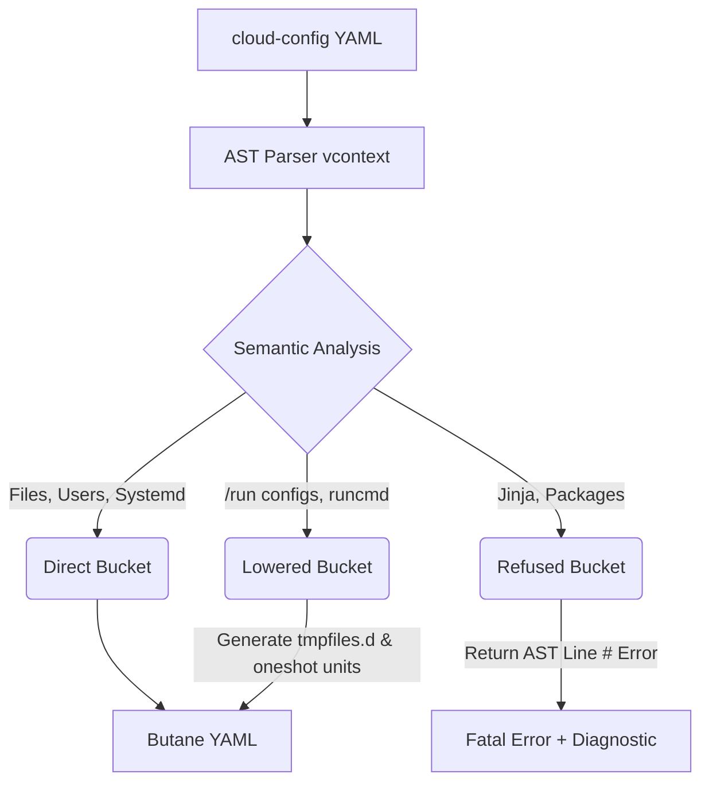

# cloud-init-to-butane

A robust transpiler converting standard `cloud-config` into [Butane](https://coreos.github.io/butane/) YAML (Ignition spec v3) tailored specifically for Flatcar Container Linux.

## The Problem

Flatcar Container Linux boots from an immutable filesystem using [Ignition](https://coreos.github.io/ignition/), which runs *once* in the `initramfs` before the real root is mounted. 

Tools like Cluster API (CAPI) often generate `cloud-config` files. Converting `cloud-config` to Butane is **not** a simple field-by-field YAML mapping. A naive mapping produces a config that validates perfectly but fails silently at runtime.

This transpiler implements an AST-aware parser and an OS-level translation layer that understands the semantics of Flatcar boot operations.

## Architecture

This tool divides the transpilation process into three semantic buckets:



## The "Lowering" Bucket

A structural translation (Direct Bucket) works for basic files and users, but fails on operational assumptions. This tool automatically lowers problematic directives into Flatcar-native primitives.

### 1. The `/run` and `/tmp` problem
CAPI's worker template writes the `kubeadm` join config to `/run/kubeadm/kubeadm-join-config.yaml`. 
Ignition runs before `/run` is mounted. Writing to it is discarded. 

**Our Solution**: Instead of rewriting user shell commands (which introduces subtle bugs), we map `/run` writes to `/var/tmp/cloud-init-staged/run/...` and generate an `/etc/tmpfiles.d/` copy rule. The file materializes at the exact path the `runcmd` expects it, without modifying the user's shell script.

### 2. The `runcmd` execution phase
`cloud-config` allows arbitrary `runcmd` scripts. Ignition does not have a declarative equivalent.

**Our Solution**: The transpiler bundles all `runcmd` and `preKubeadmCommands` into an `/opt/cloud-init/runcmd.sh` script, and generates a `cloud-init-runcmd.service` `oneshot` unit. Crucially, the unit is configured with `After=systemd-tmpfiles-setup.service` to ensure all staged files (from the problem above) are materialized before the script runs.

## The "Refused" Bucket

Using `gopkg.in/yaml.v3` and `coreos/vcontext`, we retain line and column numbers. If the input config relies on semantics impossible to transpile safely, we refuse compilation with an exact pointer.

- **Jinja Templates**: CAPI outputs `## template: jinja`. We detect this immediately and refuse, directing the user to `coreos-metadata.service`.
- **Packages**: Flatcar is immutable. `packages` or `apt` directives are rejected with a pointer to `systemd-sysext`.

```text
$ cloud-init-to-butane --in capi-worker.yaml --out worker.bu
Parse error: line 42: packages has no Flatcar equivalent; see systemd-sysext
```

## Usage

```bash
cloud-init-to-butane --in <cloud-config.yaml> --out <config.bu>
```

### Developing

Run the differential and unit testing suite:
```bash
go test -v ./...
```

The test suite asserts AST line-number correctness on failures, and validates unit generation logic.
